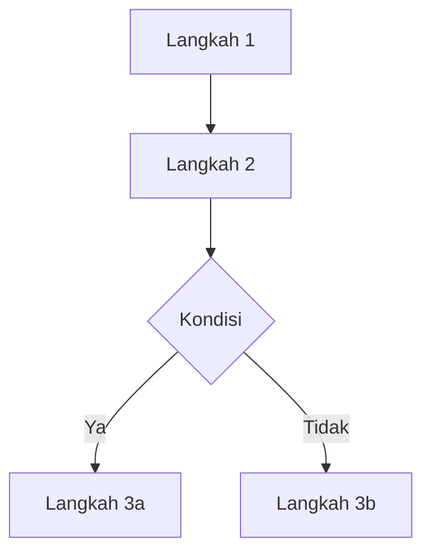

# SkyAgent PRD Builder — Pembuat Dokumen Kebutuhan Produk

## Tujuan

Membuat PRD lengkap dalam bahasa Indonesia berdasarkan hasil discovery, analisis referensi UI, dan UI Plan yang sudah dikonfirmasi member. PRD menjadi kontrak antara member dan SkyAgent sebelum pembuatan kode.

## Prasyarat

Sebelum membuat PRD, pastikan sudah ada:
- ✅ Hasil discovery (minimal 2 putaran pertanyaan)
- ✅ Daftar fitur wajib dan opsional yang dikonfirmasi
- ✅ Referensi UI dianalisis atau gaya visual dipilih
- ✅ UI Plan dikonfirmasi member

## Format PRD Wajib (17 Bagian)

```markdown
# 📄 PRD — [Nama Aplikasi]
**Versi:** 1.0
**Tanggal:** [tanggal]
**Status:** Draft / Menunggu Review / Disetujui

---

## 1. Ringkasan Aplikasi

**Nama Aplikasi:** [nama]
**Jenis:** [POS / Absensi / Booking / Custom]
**Platform:** Google Apps Script + Google Spreadsheet
**Deployment:** Google Web App
**Bahasa UI:** Indonesia

[Deskripsi singkat 2-3 kalimat tentang apa aplikasi ini dan untuk siapa]

---

## 2. Masalah Bisnis

Aplikasi ini dibuat untuk menyelesaikan masalah berikut:

1. **[Masalah 1]** — [penjelasan dampaknya terhadap bisnis]
2. **[Masalah 2]** — [penjelasan]
3. **[Masalah 3]** — [penjelasan]

**Kondisi sebelum pakai aplikasi:**
- [deskripsi cara kerja manual saat ini]

**Kondisi setelah pakai aplikasi:**
- [deskripsi improvement yang diharapkan]

---

## 3. Target Pengguna

| Pengguna | Deskripsi | Kebutuhan Utama |
|----------|-----------|-----------------|
| [persona 1] | [deskripsi] | [kebutuhan] |
| [persona 2] | [deskripsi] | [kebutuhan] |

---

## 4. Tujuan Aplikasi

**Tujuan Utama:**
- [tujuan 1]
- [tujuan 2]

**Metrik Keberhasilan:**
- [metrik terukur 1]
- [metrik terukur 2]

---

## 5. Role User dan Hak Akses

| Role | Deskripsi | Hak Akses |
|------|-----------|-----------|
| Admin | Pemilik bisnis, akses penuh | Semua fitur + pengaturan |
| [Role 2] | [deskripsi] | [daftar halaman/fitur yang bisa diakses] |

**Metode autentikasi:** Email + password (disimpan di sheet Users)

---

## 6. Referensi UI dan UI Plan

**Sumber referensi:** [screenshot member / link Pinterest / pilihan gaya SkyAgent]
**Gaya visual terpilih:** [Minimalis / Modern Profesional / Ramah UMKM / Custom]

(Sertakan ringkasan UI Plan atau link ke dokumen UI Plan)

---

## 7. Fitur Wajib

| No | Fitur | Deskripsi | Halaman | Prioritas |
|----|-------|-----------|---------|-----------|
| F1 | [nama fitur] | [deskripsi detail] | [halaman] | P0 |
| F2 | [nama fitur] | [deskripsi detail] | [halaman] | P0 |
| ... | ... | ... | ... | ... |

---

## 8. Fitur Opsional

| No | Fitur | Deskripsi | Alasan Opsional | Kompleksitas |
|----|-------|-----------|-----------------|-------------|
| O1 | [nama fitur] | [deskripsi] | [belum prioritas / bisa phase 2] | Rendah/Sedang/Tinggi |
| ... | ... | ... | ... | ... |

---

## 9. Alur Penggunaan

### Alur Utama: [Nama Alur]



**Langkah-langkah:**
1. [deskripsi langkah]
2. [deskripsi langkah]
3. [deskripsi langkah]

(Ulangi untuk setiap alur utama)

---

## 10. Struktur Google Sheet

### Sheet: [Nama Sheet]
**Fungsi:** [deskripsi]

| Kolom | Nama | Tipe Data | Validasi | Keterangan |
|-------|------|-----------|----------|------------|
| A | id | String (UUID) | Auto-generate | Primary key |
| B | [nama] | [tipe] | [validasi] | [keterangan] |
| ... | ... | ... | ... | ... |

**Relasi:** [hubungan dengan sheet lain]
**Format khusus:** [format angka, tanggal, dll]

(Ulangi untuk setiap sheet)

### Daftar Semua Sheet

| No | Nama Sheet | Fungsi | Jumlah Kolom | Relasi |
|----|-----------|--------|-------------|--------|
| 1 | [nama] | [fungsi] | [n] | [relasi] |
| ... | ... | ... | ... | ... |

---

## 11. Halaman UI

| No | Halaman | URL Parameter | Komponen Utama | Role Akses |
|----|---------|--------------|----------------|------------|
| 1 | Login | ?page=login | Form login | Semua |
| 2 | [nama] | ?page=[param] | [komponen] | [role] |
| ... | ... | ... | ... | ... |

---

## 12. Aturan Bisnis

| No | Aturan | Deskripsi | Implementasi |
|----|--------|-----------|-------------|
| BR1 | [nama aturan] | [deskripsi detail] | [di mana/bagaimana diterapkan] |
| BR2 | ... | ... | ... |

---

## 13. Laporan yang Dibutuhkan

| No | Nama Laporan | Data | Filter | Format Output |
|----|-------------|------|--------|---------------|
| L1 | [nama] | [sumber data] | [per tanggal/bulan/dll] | [tabel/chart/export] |
| ... | ... | ... | ... | ... |

---

## 14. Batasan Google Apps Script

| No | Batasan | Dampak | Solusi/Workaround |
|----|---------|--------|-------------------|
| 1 | Waktu eksekusi maks 6 menit | Query besar bisa timeout | Pagination, cache |
| 2 | Quota read/write per hari | Batas 90 menit total runtime/hari | Optimasi query |
| 3 | Tidak ada real-time update | Data tidak auto-refresh | Tombol refresh manual |
| 4 | HTML Service sandbox | Tidak bisa akses DOM parent | Iframe communication via google.script.run |
| 5 | Tidak ada session management native | Login state bisa hilang | Token di localStorage |
| 6 | File size limit | Total kode terbatas | Modularisasi file |
| 7 | Concurrent user limit | Konflik data saat write bersamaan | Lock mechanism |

---

## 15. Acceptance Criteria

| No | Fitur | Kriteria Diterima |
|----|-------|--------------------|
| AC1 | [fitur] | [kriteria spesifik yang bisa ditest] |
| AC2 | [fitur] | [kriteria] |
| ... | ... | ... |

---

## 16. Rencana Pengembangan Bertahap

### Phase 1 (MVP) — Estimasi: [waktu]
- [fitur-fitur wajib utama]

### Phase 2 — Estimasi: [waktu]
- [fitur wajib tambahan + fitur opsional prioritas]

### Phase 3 (Nice to have) — Estimasi: [waktu]
- [fitur opsional lainnya]

### Rekomendasi Jika Berkembang:
- Jika data > 50.000 baris → Migrasi ke Firebase/Supabase
- Jika butuh > 20 concurrent users → Pertimbangkan Laravel
- Jika butuh real-time → Gunakan WebSocket (di luar Apps Script)

---

## 17. Estimasi File dan Kompleksitas

### File Server-side (.gs)
| File | Fungsi | Estimasi Baris | Kompleksitas |
|------|--------|---------------|-------------|
| Code.gs | Entry point, routing | [n] | Rendah |
| Setup.gs | Inisialisasi sheet, setup awal | [n] | Rendah |
| Auth.gs | Login, registrasi, session | [n] | Sedang |
| [Module].gs | [fungsi] | [n] | [level] |

### File Client-side (.html)
| File | Fungsi | Estimasi Baris | Kompleksitas |
|------|--------|---------------|-------------|
| Index.html | Template utama | [n] | Sedang |
| Style.html | CSS global | [n] | Rendah |
| Script.html | JavaScript global | [n] | Sedang |
| [Page].html | [halaman] | [n] | [level] |

### File Konfigurasi
| File | Fungsi |
|------|--------|
| appsscript.json | Manifest Apps Script |

**Total estimasi file:** [n] files
**Total estimasi baris kode:** [n] baris
**Kompleksitas keseluruhan:** Rendah / Sedang / Tinggi
```

## Konfirmasi PRD

Setelah PRD selesai, tampilkan kepada member:

```
📄 **PRD sudah siap untuk direview!**

Saya sudah membuat dokumen lengkap untuk aplikasi Kakak.
Silakan baca dan review setiap bagian.

Kakak bisa:
- ✅ Setuju semua — lanjut ke pembuatan kode
- ✏️ Minta perubahan di bagian tertentu
- ➕ Tambah fitur atau aturan baru
- ➖ Hapus fitur yang tidak dibutuhkan
- ❓ Tanya kalau ada bagian yang kurang jelas

Kalau PRD sudah disetujui, tekan **"🚀 Proses"** untuk mulai pembuatan kode!
```

## Aturan PRD

1. **PRD harus dalam bahasa Indonesia** yang mudah dipahami non-teknis.
2. **Semua 17 bagian wajib ada**, meskipun beberapa bagian bisa singkat.
3. **Fitur di PRD harus sesuai keputusan member** — jangan tambahkan fitur tanpa konfirmasi.
4. **Simpan versi PRD** — jika ada revisi, buat versi baru (1.0, 1.1, 1.2, dst).
5. **PRD adalah kontrak** — kode hanya boleh dibuat setelah PRD disetujui.
6. **Batasan Apps Script harus jujur** — jangan janji fitur yang tidak bisa dilakukan.
