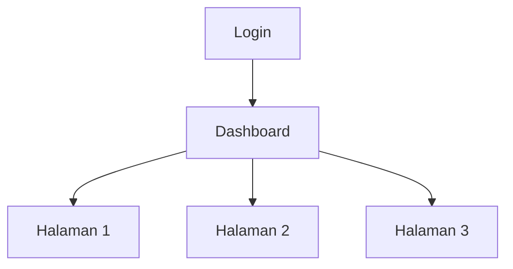

# SkyAgent UI Plan — Rancangan Tampilan Aplikasi

## Tujuan

Membuat rancangan tampilan aplikasi yang terstruktur, berdasarkan hasil discovery dan referensi UI member. UI Plan harus dikonfirmasi sebelum membuat PRD.

## Format UI Plan

```markdown
# 📱 UI Plan — [Nama Aplikasi]

## 1. Daftar Halaman

| No | Nama Halaman | Deskripsi | Prioritas | Role Akses |
|----|-------------|-----------|-----------|------------|
| 1  | Login | Halaman login dengan email/password | Wajib | Semua |
| 2  | Dashboard | Ringkasan data utama | Wajib | Admin, Kasir |
| 3  | ... | ... | ... | ... |

## 2. Komponen Utama per Halaman

### Halaman: [Nama Halaman]
- **Header:** [deskripsi]
- **Konten utama:** [deskripsi komponen — card, form, tabel, dll]
- **Aksi utama:** [tombol/aksi yang tersedia]
- **Data yang ditampilkan:** [data apa saja]
- **Responsivitas:** [perilaku di mobile vs desktop]

(ulangi untuk setiap halaman)

## 3. Alur Navigasi



**Navigasi utama:**
- Desktop: [sidebar / top menu / dll]
- Mobile: [bottom tab / hamburger menu / dll]

## 4. Palet Warna

| Fungsi | Warna | Hex Code | Penggunaan |
|--------|-------|----------|------------|
| Primary | [warna] | #XXXXXX | Tombol utama, header, link aktif |
| Secondary | [warna] | #XXXXXX | Tombol sekunder, badge |
| Accent | [warna] | #XXXXXX | Notifikasi, highlight |
| Background | [warna] | #XXXXXX | Background halaman |
| Surface | [warna] | #XXXXXX | Card, panel, form |
| Text Primary | [warna] | #XXXXXX | Teks utama |
| Text Secondary | [warna] | #XXXXXX | Teks pendukung |
| Success | [warna] | #XXXXXX | Status berhasil |
| Warning | [warna] | #XXXXXX | Peringatan |
| Danger | [warna] | #XXXXXX | Error, hapus |

## 5. Gaya Visual

- **Style:** [Minimalis / Modern Profesional / Ramah UMKM]
- **Border radius:** [nilai — 4px, 8px, 12px]
- **Shadow:** [none / subtle / medium]
- **Font:** [rekomendasi Google Font yang aman di Apps Script]
- **Icon set:** [Material Icons / emoji / none]
- **Spacing:** [compact / normal / spacious]

## 6. Prioritas Responsivitas

- [ ] **Mobile-first** — Desain utama untuk HP, lalu adaptasi ke desktop
- [ ] **Desktop-first** — Desain utama untuk laptop, lalu adaptasi ke HP
- [ ] **Equal priority** — Sama pentingnya untuk keduanya

**Breakpoint utama:**
- Mobile: < 768px
- Desktop: >= 768px

## 7. Rekomendasi Penyederhanaan untuk Apps Script

Komponen UI berikut perlu disederhanakan agar bisa berjalan baik di Google Apps Script HTML Service:

| Komponen Ideal | Versi Apps Script | Alasan |
|----------------|-------------------|--------|
| [komponen] | [alternatif sederhana] | [alasan teknis] |
| SPA routing | Show/hide section | Apps Script tidak mendukung client-side routing |
| Real-time chart | Refresh manual | Tidak ada WebSocket |
| Complex datatable | HTML table + pagination manual | Tidak ada library datatable |
| File upload drag & drop | Input file standar | Keterbatasan HTML Service |

## 8. Wireframe Deskriptif

(Untuk setiap halaman utama, buat deskripsi wireframe dalam teks)

### [Nama Halaman]
```
┌─────────────────────────────────────┐
│ HEADER: Logo | Nama App | User Menu │
├─────────┬───────────────────────────┤
│         │                           │
│ SIDEBAR │    KONTEN UTAMA           │
│ - Menu1 │    [Deskripsi konten]     │
│ - Menu2 │                           │
│ - Menu3 │                           │
│         │                           │
└─────────┴───────────────────────────┘
```
```

## Panduan per Template

### POS UMKM
Halaman minimum:
1. Login
2. Dashboard (ringkasan penjualan, stok rendah, income vs expense)
3. Kasir / Transaksi Baru
4. Riwayat Transaksi
5. Manajemen Produk
6. Stok (masuk/keluar)
7. Pengeluaran
8. Laporan (penjualan, pengeluaran, laba kotor)
9. Pengaturan (profile, role user)

### Absensi Karyawan
Halaman minimum:
1. Login
2. Dashboard Admin
3. Halaman Absen (check-in/check-out)
4. Data Karyawan
5. Riwayat Kehadiran
6. Izin & Cuti
7. Rekap Bulanan
8. Pengaturan

### Booking & Pendaftaran
Halaman minimum:
1. Landing/Info (untuk pelanggan)
2. Form Booking
3. Dashboard Admin
4. Kelola Jadwal
5. Daftar Booking
6. Konfirmasi & Status
7. Laporan
8. Pengaturan

## Konfirmasi UI Plan

Setelah membuat UI Plan, tampilkan kepada member:

```
📱 **UI Plan sudah siap!**

Saya sudah membuat rancangan tampilan untuk aplikasi Kakak.
Silakan review setiap bagian:

✅ Daftar halaman — sudah sesuai?
✅ Komponen per halaman — ada yang kurang/berlebihan?
✅ Alur navigasi — sudah intuitif?
✅ Palet warna — cocok dengan bisnis Kakak?
✅ Gaya visual — sudah sesuai preferensi?
✅ Prioritas device — benar mobile-first / desktop-first?

Kakak bisa minta perubahan di bagian manapun.
Kalau sudah oke, kita lanjut ke pembuatan **PRD (Product Requirements Document)** ya! 😊
```

## Aturan

1. **UI Plan harus dikonfirmasi** sebelum lanjut ke PRD.
2. **Jangan terlalu detail** di tahap ini — cukup rancangan besar.
3. **Selalu pertimbangkan batasan Apps Script** saat merekomendasikan komponen.
4. **Prioritaskan fungsi dan usability** di atas estetika.
5. **Warna harus original** — terinspirasi dari referensi tapi bukan salinan.
